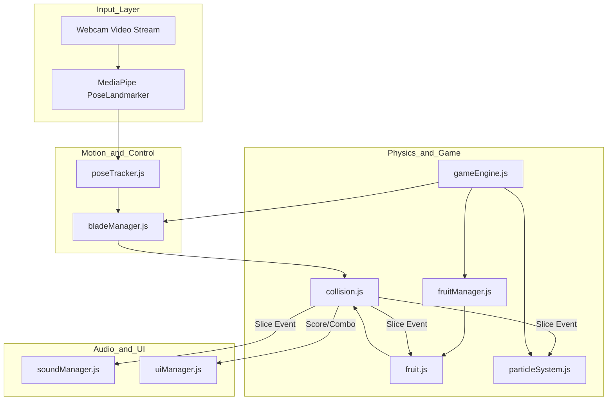

# Pose Ninja Fruit Implementation Plan

> **For agentic workers:** REQUIRED SUB-SKILL: Use superpowers:subagent-driven-development to implement this plan task-by-task. Steps use checkbox (`- [ ]`) syntax for tracking.

**Goal:** Build a zero-dependency, real-time motion-sensing Fruit Ninja web app using MediaPipe Pose, HTML5 multi-layer Canvas, Vanilla JavaScript ES Modules, and procedural Web Audio API, deployable directly to GitHub Pages.

**Architecture:** A three-canvas layered architecture separating camera background, 60 FPS game physics (fruits, bombs, particles), and interaction blades with UI. MediaPipe Pose tracks wrists and index fingers, smoothed with EMA, while segment-to-circle math computes slicing collisions and split angles.

**Architecture Diagram:**

**Tech Stack:** HTML5, CSS3, Vanilla JavaScript (ES6 Modules), MediaPipe Tasks-Vision CDN, Web Audio API, Canvas 2D.  
**Spec:** [docs/superpowers/specs/2026-11-10-pose-ninja-fruit-design.md](file:///c:/Antigravity/fruit/docs/superpowers/specs/2026-11-10-pose-ninja-fruit-design.md)

## Global Constraints
- **No-Build / CDN Only**: Zero npm install, zero bundlers; runs straight in the browser.
- **Pure Procedural Assets**: No external `.png`, `.jpg`, or `.mp3` dependencies; all graphics rendered via Canvas 2D and sounds via Web Audio API.
- **GitHub Pages Friendly**: Root-relative paths, HTTPS compatible, works on mobile front camera and desktop webcam.

---

### Task 1: Project Scaffolding & Configuration

**Files:**
- Create: `index.html`
- Create: `css/main.css`
- Create: `css/ui.css`
- Create: `js/config.js`

**Interfaces:**
- Produces: `CONFIG` object containing canvas dimensions, fruit types, colors, gravity, speeds, and audio settings.

- [ ] **Step 1: Create `js/config.js`**
  Define game constants, fruit palette, gravity, blade velocity threshold, and scoring rules.
- [ ] **Step 2: Create `css/main.css` and `css/ui.css`**
  Set up absolute viewport layering for 3 canvases, full-screen sizing, and HUD layouts.
- [ ] **Step 3: Create `index.html`**
  Set up HTML skeleton, CDN script tags for MediaPipe `@mediapipe/tasks-vision`, video element, three canvas layers, and HUD UI elements.
- [ ] **Step 4: Verify in local browser**
  Check that layers stack properly without scrollbars.
- [ ] **Step 5: Commit**
  `git add index.html css/ js/config.js; git commit -m "feat: scaffold project structure, styles and game config"`

---

### Task 2: Collision Geometry & Slicing Math Engine

**Files:**
- Create: `js/game/collision.js`
- Create: `tests/collision.test.js`

**Interfaces:**
- Consumes: Blade line segment points $A, B$ and Fruit center $C$, radius $R$.
- Produces: `checkSegmentCircleCollision(p1, p2, circle)`, `calculateSliceNormal(p1, p2)`.

- [ ] **Step 1: Write test cases for collision math**
  Write tests for direct hit, grazing hit, complete miss, and cut normal calculation.
- [ ] **Step 2: Run test with Node or browser runner to verify failure**
- [ ] **Step 3: Implement `collision.js`**
  Implement vector projection, closest point clamping on segment, and normal vector angle calculation.
- [ ] **Step 4: Verify tests pass**
- [ ] **Step 5: Commit**
  `git add js/game/collision.js tests/collision.test.js; git commit -m "feat: implement segment-circle collision detection and slicing normal math"`

---

### Task 3: Procedural Sound Engine (Web Audio API)

**Files:**
- Create: `js/audio/soundManager.js`

**Interfaces:**
- Produces: `SoundManager.init()`, `SoundManager.playSwish()`, `SoundManager.playSlice()`, `SoundManager.playBomb()`, `SoundManager.playCombo(count)`.

- [ ] **Step 1: Implement `SoundManager` with AudioContext**
  Create procedural oscillators and noise buffer for blade whoosh, fruit cut squish, bomb explosion, and combo chords.
- [ ] **Step 2: Add audio unlock handler**
  Handle browser autoplay policy via first user gesture (Click / Tap).
- [ ] **Step 3: Verify procedural audio output in browser**
- [ ] **Step 4: Commit**
  `git add js/audio/soundManager.js; git commit -m "feat: implement procedural Web Audio API sound generator"`

---

### Task 4: Procedural Fruit & Bomb Physics Entity

**Files:**
- Create: `js/game/fruit.js`

**Interfaces:**
- Consumes: `CONFIG.FRUITS`, Canvas 2D context.
- Produces: `Fruit` class supporting `update(dt)`, `draw(ctx)`, `slice(cutAngle, normal)`, and `HalfFruit` class.

- [ ] **Step 1: Implement procedural rendering for 5 fruit types and bomb**
  Canvas 2D drawing methods for Watermelon, Orange, Apple, Pineapple, Banana, and Bomb.
- [ ] **Step 2: Implement parabolic trajectory physics**
  Support initial launch velocity $(v_x, v_y)$, gravity $g$, and angular spin $\omega$.
- [ ] **Step 3: Implement `slice()` method**
  Split fruit into two halves rotated at `cutAngle`, each ejected sideways along the normal vector $\pm \vec{N}$.
- [ ] **Step 4: Commit**
  `git add js/game/fruit.js; git commit -m "feat: implement procedural fruit rendering, parabolic physics, and sliced halves"`

---

### Task 5: Particle & Splash FX System

**Files:**
- Create: `js/game/particleSystem.js`

**Interfaces:**
- Consumes: Fruit color, cut point $(x, y)$, cut normal.
- Produces: `ParticleSystem.createFruitSplash(x, y, color, normal)`, `ParticleSystem.createBladeSparks(x, y)`, `update(dt)`, `draw(ctx)`.

- [ ] **Step 1: Implement Juice Splatters and Spark Particles**
  Physics particles with alpha fading, gravity, size shrinkage, and wall/floor fade.
- [ ] **Step 2: Add blade trail spark generation**
  Tiny glowing embers generated during high-speed swings.
- [ ] **Step 3: Commit**
  `git add js/game/particleSystem.js; git commit -m "feat: implement juice particle system and blade sparks"`

---

### Task 6: MediaPipe Pose Integration & Camera Manager

**Files:**
- Create: `js/camera/cameraManager.js`
- Create: `js/camera/poseTracker.js`

**Interfaces:**
- Produces: `CameraManager.start()`, `PoseTracker.init()`, `PoseTracker.detect(videoElement)` emitting wrists and index finger coordinates.

- [ ] **Step 1: Implement `cameraManager.js`**
  Request `mediaDevices.getUserMedia({ video: { facingMode: 'user' } })` with fallback resolutions and orientation handling.
- [ ] **Step 2: Implement `poseTracker.js` using `@mediapipe/tasks-vision`**
  Load PoseLandmarker with WASM files via CDN, configure running mode `VIDEO`.
- [ ] **Step 3: Extract & normalize mirrored hand coordinates**
  Extract landmarks 15, 16 (wrists) and 19, 20 (index fingers) and convert to canvas pixels with horizontal flipping.
- [ ] **Step 4: Commit**
  `git add js/camera/cameraManager.js js/camera/poseTracker.js; git commit -m "feat: integrate camera stream and MediaPipe PoseLandmarker"`

---

### Task 7: Neon Blade Tracker & Velocity Smoothing

**Files:**
- Create: `js/game/bladeManager.js`

**Interfaces:**
- Consumes: Raw wrist/index landmarks from `poseTracker.js`.
- Produces: `BladeManager.update(landmarks)`, `BladeManager.draw(ctx)`, `BladeManager.getActiveBlades()`.

- [ ] **Step 1: Implement EMA smoothing filter**
  Filter incoming points with $\alpha = 0.65$ to eliminate webcam jitter.
- [ ] **Step 2: Calculate hand velocity and active threshold**
  Calculate speed over last 6 samples; activate blade only when speed $\ge 400\text{ px/s}$.
- [ ] **Step 3: Render glowing neon trail**
  Catmull-Rom spline path with `globalCompositeOperation = 'lighter'` and cyan/magenta glowing trails.
- [ ] **Step 4: Commit**
  `git add js/game/bladeManager.js; git commit -m "feat: implement smoothed neon blade trails and velocity thresholding"`

---

### Task 8: Fruit Wave Spawner & Game Lifecycle Manager

**Files:**
- Create: `js/game/fruitManager.js`

**Interfaces:**
- Consumes: `Fruit`, `collision.js`, `SoundManager`, `ParticleSystem`.
- Produces: `FruitManager.update(dt, activeBlades)`, `FruitManager.spawnWave()`, callbacks for `onScore`, `onMiss`, `onBomb`.

- [ ] **Step 1: Implement wave spawning pattern**
  Randomized launch intervals, 1 to 4 fruits per wave with occasional bombs.
- [ ] **Step 2: Connect blade collision to fruit slicing**
  Check active blade line segments against all active fruits each frame.
- [ ] **Step 3: Implement multi-slice combo detection**
  Count slices within 300ms window; trigger combo bonus when $\ge 3$ fruits sliced.
- [ ] **Step 4: Commit**
  `git add js/game/fruitManager.js; git commit -m "feat: implement fruit spawner waves, slicing collision checks, and combo logic"`

---

### Task 9: UI Manager, Game Engine Loop & Main Bootstrap

**Files:**
- Create: `js/ui/uiManager.js`
- Create: `js/game/gameEngine.js`
- Create: `js/main.js`

**Interfaces:**
- Consumes: All modules.
- Produces: Start screen, live HUD (Score, Hearts, Combo banners), Game Over modal, 60 FPS RAF game loop.

- [ ] **Step 1: Implement `uiManager.js`**
  HUD update for score counter, heart lives (3 lives), animated combo popup, high-score tracking in `localStorage`.
- [ ] **Step 2: Implement `gameEngine.js`**
  Main loop coordinating `bladeManager`, `fruitManager`, `particleSystem`, and canvas renderers.
- [ ] **Step 3: Implement `main.js`**
  Bootstrap application, attach event listeners for Start/Restart buttons and camera permissions.
- [ ] **Step 4: Commit**
  `git add js/ui/uiManager.js js/game/gameEngine.js js/main.js; git commit -m "feat: integrate UI manager, game engine loop, and main entry point"`

---

### Task 10: Full End-to-End Testing & GitHub Pages Verification

**Files:**
- Create: `README.md` (Game guide, instructions, camera tips, GitHub Pages deployment guide)

- [ ] **Step 1: Start local web server and verify complete gameplay loop**
- [ ] **Step 2: Verify camera feed, pose skeleton overlay, and mirroring**
- [ ] **Step 3: Test slicing physics, combos, bomb explosions, and sound effects**
- [ ] **Step 4: Test responsive layout on mobile viewport emulation**
- [ ] **Step 5: Write comprehensive `README.md` and commit**
  `git add README.md; git commit -m "docs: add game guide, gameplay controls, and GitHub Pages setup instructions"`
